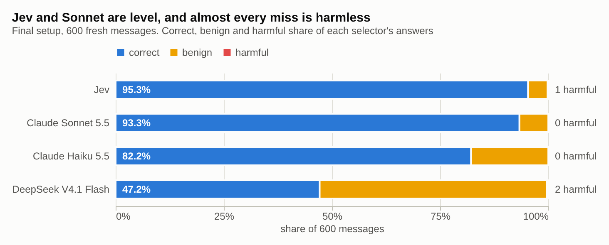

# Who picks the tool?

**Measuring tool selection on 90 real MCP tools: a small choice model against LLM agents.**

## Background

I built this for a talk at MeasureCamp Sydney in October 2026. I was curious about Jev, TypeSafe's small
choice model: how well it could classify intent, and whether it could replace the tool-selection step of an
LLM with native tool calling, which can be expensive.

## The question

A customer writes to an online store's AI assistant. The assistant has 91 options: 90 tools copied word for
word from seven official MCP servers (Shopify, Stripe, Intercom, GitHub, Notion) and one more for when none
of them fits, which hands the conversation to a person. Which should it pick first, and what happens when it
picks wrong?

This study runs four selectors on the same 600 customer messages and scores every answer against an answer
key audited by hand: TypeSafe's **Jev** (a small model that answers one multiple-choice question) and
**DeepSeek V4.1 Flash, Claude Haiku 5.5 and Claude Sonnet 5.5** as tool-calling agents. Every raw API response
is committed, so every number below can be recomputed without an API key.



## What I found

| selector | correct | benign miss | harmful | median time | US$ per 1,000 messages |
|---|---|---|---|---|---|
| Jev (pick, then a call to fill the arguments) | 95.3% | 4.5% | 0.2% | 1.4 s | 0.34 |
| Claude Sonnet 5.5 | 93.3% | 6.7% | 0.0% | 1.8 s | 9.07 |
| Claude Haiku 5.5 | 82.2% | 17.8% | 0.0% | 1.7 s | 0.85 |
| DeepSeek V4.1 Flash | 47.2% | 52.5% | 0.3% | 2.0 s | 0.28 |

1. **A tie at the top, at 27 times the price.** Jev and Sonnet are two points apart, and on the same messages
   that isn't a real gap (exact McNemar p = 0.16). Sonnet costs US$9.07 per 1,000 messages; Jev US$0.34.
2. **Almost every miss is harmless.** A miss is usually a needless hand-off or a question back. Only 3 answers
   in 2,400 were a wrong call, once every model had a written routing policy and a hand-off option.
3. **How the model is allowed to answer matters more than which model it is.** DeepSeek scores 47% as a free
   agent and 91% when told to name one tool: a 44-point swing for the same model on the same messages.
4. **The setup moved the scores more than the models did.** Writing the routing policy into the prompt added
   7 to 33 points. One line of customer wording on six tool descriptions added 11. Auditing the answer key
   moved scores by up to 15 points and reordered the selectors.
5. **A word-counting baseline ties the leaders.** A naive Bayes intent classifier that looks the tool up in
   the answer key scores 95.2%. That says what this benchmark mostly measures, and it is the first limitation
   below.


## Jev only picks the tool

Jev answers one question: which of the 91 options? It doesn't write the tool's arguments and it can't reply
to the customer. An LLM agent does all of that in one call. So the Jev row above is a two-call pipeline:

| step | model | what it reads | median time | US$ per 1,000 |
|---|---|---|---|---|
| 1. pick the tool | Jev 1.14.0 | the message, the policy, and 91 tool names and descriptions (7,207 tokens) | 0.26 s | 0.30 |
| 2. fill in the arguments | DeepSeek V4.1 Flash (through OpenRouter, served by DeepInfra) | the message, the agents' system prompt, and only the one tool Jev picked, which it is forced to call (526 tokens) | 1.1 s | 0.035 |

Jev's time and cost in every table include both calls (`scripts/run_jev_fill.py`, `runs/fill/jev_fresh.jsonl`).

- **Jev doesn't remove the LLM.** It removes the expensive part of the LLM's job: reading 76,000 tokens of
  tool schemas to decide. The second call reads about 500.
- **DeepSeek was chosen because it was the cheapest model in the study.** I didn't compare other models for
  this step.
- **The second call ran for every pick, including hand-offs.** 61% of Jev's picks were hand-offs, where the
  call only writes a one-line reason. A production build could use a fixed reason there and skip the call,
  which would save more than half of the second step's cost.
- **A picker that can't ask is the weak point.** On "I want my money back" Jev picks a return or refund tool,
  and the second call, forced to call it, invents the order line it needs (13 of 232 checked calls). Letting
  the second call ask instead made it override Jev: it asked on 208 of 600 messages, 136 of them correct
  hand-offs. With arguments counted, Jev scores 93.2% and Sonnet 93.3%.

## What weakens the result

I checked the headline against itself. Each of these is measured in the notebook (Part 5).

- **It is mostly intent recognition.** That is what I set out to test, and Jev did it with no training data:
  from tool descriptions and a three-rule policy it matched a naive Bayes classifier trained on 22,317
  labelled messages. But it limits what the result proves. The answer key is per intent, so a selector can
  score well without weighing one tool description against another, and the test can't show how the selectors
  compare when the right tool depends on the details of a message, on requests outside the 27 intents, or on
  tools that change.
- **The ranking depends on the mix of requests.** Half the messages have no tool that fits. Jev is better on
  those (99.7% against 93.9%), Sonnet on the rest (92.7% against 90.7%). Below about 26% no-tool requests,
  Sonnet leads.
- **The messages aren't independent.** Resampling whole intents instead of messages widens the interval on
  Jev minus Sonnet from [-0.7, +4.5] to [-2.7, +6.5] points.
- **"Harm is rare" leans on a labelling rule added after the final run.** Reading the customer's own records
  or the FAQ counts as benign. Without that rule there are 79 harmful answers in 2,400, not 3, nearly all of
  them an FAQ search where the policy says to hand off.
- **Mode and model are tangled.** Jev must pick an option; the agents may ask a question. That is how each is
  deployed, but it is not a like-for-like comparison of models.
- **Synthetic, short, single-turn messages** (Bitext, template-generated), one run per selector, one store's
  tool list, and only the first call is scored.

## How a real deployment would differ

The study isolates one decision: the first tool call for one message, with nothing else known. A production
assistant differs in ways that would move these numbers. They are ordered by how much I think they matter,
which is a judgement and not a measurement.

1. **The store would have tools for the gaps.** Here 52% of messages have no tool, because no official
   customer-side server can cancel an order or change an address. A real store would add its own tools for
   those. Jev's lead came entirely from hand-offs (99.7% against Sonnet's 93.9%), and below about 26% no-tool
   requests Sonnet leads. This is probably the biggest change, and it favours the agents.
2. **Conversations have more than one turn.** Only the first call is scored, so a question back counts as a
   miss. If every question had been followed by the right call, Sonnet would reach at most 97.8%, Haiku 95.2%
   and DeepSeek 83.5%. Those are ceilings: most of the questions were on requests where the right move was to
   hand off, so the question only delays it. Jev can't ask at all, and giving it a "need more information"
   option cost it eight points (95.3% to 87.5%). In a conversation Jev would also need the earlier turns in
   its input, which I didn't test.
3. **The system already knows the customer.** A logged-in customer's recent orders, payments and open
   tickets can go in the system prompt. Here 86% of messages carry no order number, invoice number or amount,
   so the selectors had to look something up or ask. With that context, "I want my money back" points at a
   known order: lookups stop being the right first call, questions are needed less often, and the invented
   order lines in Jev's second call should mostly disappear. The answer key would need rewriting, and whether
   Jev uses that kind of context well is untested.
4. **Tools run, return results and fail.** No tool was executed here. A real request is often a chain (look
   up the order, then request the return), with empty results and errors along the way, and something has to
   run that loop and write the reply. That something is an LLM. So Jev would replace the selection step inside
   an agent loop, not the agent, and whether it picks well on the second step, given a tool's result, is
   untested.
5. **Some messages need no tool.** "Thanks", a greeting, a general question. This study has no "just reply"
   option: every message gets a tool or a hand-off. An agent replies on its own. A picker needs that added as
   another option, or it hands "thanks" to a person.
6. **Real traffic is skewed and messier.** Every intent has 22 or 23 messages here. In a real queue a few
   intents dominate, so overall accuracy depends on the mix. Real messages are also longer, ask for two things
   at once, come in other languages and sometimes try to manipulate the assistant. Bitext has none of that.
7. **Mistakes have prices.** Jev's misses are almost all needless hand-offs (26 of 28), which cost staff
   time. Sonnet's are mostly questions (27 of 40), which cost the customer a turn. Jev makes 35 more needless
   hand-offs per 1,000 messages than Sonnet, and Sonnet costs US$8.73 more per 1,000 in model fees. So if a
   needless hand-off costs the business more than about 25 US cents, Sonnet is the cheaper choice on this mix,
   before counting what its extra questions cost. Real systems also confirm before a refund or other write,
   which makes a wrong call less harmful and a needless hand-off relatively more expensive.
8. **Things change.** The runs used Jev 1.14.0 through the `jev-latest` alias, which moves. Vendors rewrite
   tool descriptions, and the store's policy changes. The customer wording was tuned on one sample's misses
   and needs upkeep. The pipeline also has two vendors in its path, so two sets of rate limits and outages,
   and two places the customer's text is sent.

**What I expect to survive.** Most of these favour the agents: fewer gaps, more turns and more context all
play to a model that can read, ask and act. What should hold up is narrower: choosing among many tools is the
expensive part of an agent's call, a small model can do that part about as well on clear requests, and misses
are mostly safe once there is a written policy and a hand-off. Whether that is worth a two-call pipeline
depends on the price of a hand-off and on how often the request is one a tool can handle.

## Look around

| | |
|---|---|
| [`notebooks/tool_selection.ipynb`](notebooks/tool_selection.ipynb) | **Start here.** The whole study in six parts: data, experiment (with a small live run), results, why, limitations, cost. Renders on GitHub. |
| [`docs/RESULTS.md`](docs/RESULTS.md) | Every table in full, including the variants that didn't make the headline (argument checks, a "need more information" option for Jev, a local contrastive model, prompt optimisation with GEPA). |
| [`src/toolpick/`](src/toolpick) | The package: data and answer key (`data.py`), scoring and paired statistics (`scoring.py`), prompts, the request builder used for every call (`live.py`), the argument check. |
| [`tests/`](tests) | 46 tests, including one file that pins the published numbers to the committed runs. |
| `ledger/index.html` | Every decision in every run on one filterable page (open it locally; 6 MB). |
| [`notebooks/rerun_failures.ipynb`](notebooks/rerun_failures.ipynb) | Re-sends sampled failures to see which repeat (needs keys; about US$0.40). |
| `notebooks/explore.py` | A marimo app for browsing the data and errors interactively. |
| [`data/REPORT.md`](data/REPORT.md) | Where each of the 90 tools came from: server, version, how it was retrieved, licence. |

## Run it

```bash
uv sync                                    # Python 3.12
uv run pytest                              # 46 tests, a few seconds, no network
uv run jupyter lab notebooks/              # the walkthrough
uv run marimo edit notebooks/explore.py    # the interactive explorer
```

None of that needs an API key. To make new calls, copy `.env.example` to `.env` and fill in the keys. The
notebook's live cells then send five messages to two selectors (a cent or less), and its `FULL_RUN` switch
repeats the whole final run (about US$6, nearly all of it Sonnet). The scripts behind each table are listed
in [`docs/RESULTS.md`](docs/RESULTS.md#commands).

To rebuild the generated files:

```bash
uv run python scripts/build_notebook.py && uv run jupyter nbconvert --to notebook --execute --inplace notebooks/tool_selection.ipynb
uv run python scripts/build_figures.py     # the charts on this page
uv run python scripts/build_ledger.py      # ledger/index.html
```

## How it is built

- **Real tools, with provenance.** Each tool's name, description and schema is the vendor's own, retrieved by
  running the official server and calling `tools/list` where possible. Nothing was paraphrased.
- **An answer key with a paper trail.** A first-pass key from the docs, then an audit of every failure. Each
  change is one line in `src/toolpick/data.py` with its reason, and both versions can be scored.
- **A held-out final sample.** The setup (policy, tool wording, key) was developed on 600 messages and tested
  once on 600 different ones.
- **Paired statistics.** Selectors are compared on the same messages with an exact McNemar test and a
  bootstrap interval, not by eyeballing two percentages.
- **Outcomes, not only accuracy.** Each answer is one of six outcomes that fold into correct, benign and
  harmful, because a hand-off and a wrong refund are not the same miss.
- **Everything is on disk.** One JSON line per call with the pick, usage, billed cost, latency, timestamp and
  the full API response. Runs append as they go and resume where they stopped. All the API calls together cost
  about US$30.


## Layout

| Path | What |
|---|---|
| `data/requests_fresh.jsonl`, `data/requests.jsonl` | the 600 fresh messages (final results) and the first 600 (development) |
| `data/catalog.json`, `data/REPORT.md` | the 90 real tools and how each was retrieved |
| `data/intent_map.json` | the research pass behind the answer key: per intent, acceptable and partial tools with notes |
| `src/toolpick/` | the package (see above) |
| `runs/fresh/` | the final runs; `runs/fill/` holds the argument-filling calls for Jev's picks |
| `runs/*.jsonl`, `runs/experiments/` | development runs and the experiments on Jev's question |
| `scripts/run_*.py` | the runners; `scripts/build_*.py` generate the notebook, charts, ledger and slides |
| `clm/` | setup notes for running the CLM-8B contrastive model locally as a fifth selector |
| `slides/` | the draft deck for the talk |

## Licences and provenance

Code: MIT (see `LICENSE`). Messages: Bitext customer-support dataset (CDLA-Sharing-1.0). Tool text: Stripe
(`@stripe/mcp` 0.2.5, MIT), GitHub (`github-mcp-server` 2.0.3, MIT), Notion (`@notionhq/notion-mcp-server`
2.5.2, MIT); Shopify (live `tools/list` on a public store) and Intercom (docs summaries) are the vendors' own
text, reproduced here for research. See `data/REPORT.md`.
