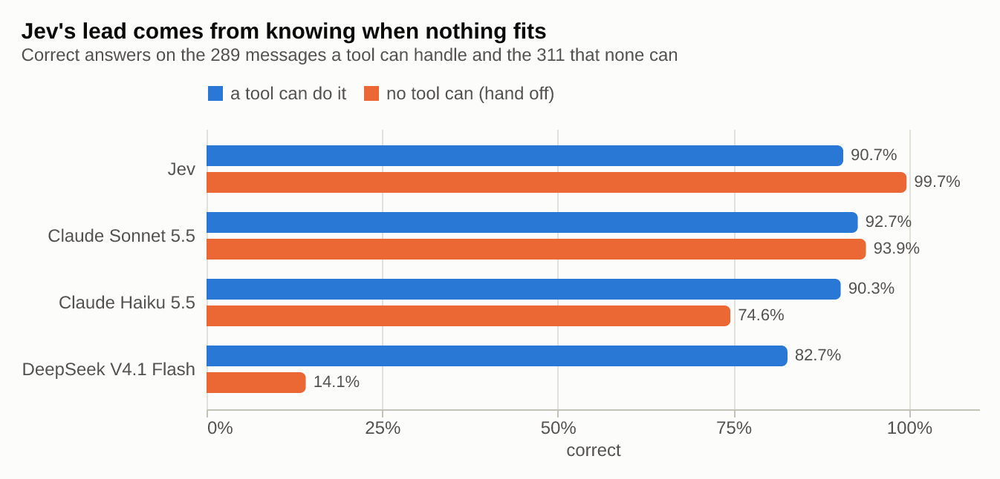

# Who picks the tool?

**Measuring tool selection on 90 real MCP tools: a small choice model against LLM agents.**

## TL;DR

**Jev can replace the tool-selection step of an agent, not the agent.** On 600 customer messages and 90 real
tools it picked the right tool as often as Claude Sonnet 5.5 running as a tool-calling agent (95.3% against
93.3%, a statistical tie) at about one twenty-seventh of the cost (US$0.34 against US$9.07 per 1,000 messages).
But it can't ask a question or fill in a tool's arguments, so an LLM still has to do the rest.

- **Where it fits:** many tools, clear requests, high volume. Reading 76,000 tokens of tool schemas to pick one
  is the expensive part of an agent's call, and a small model did that part as well.
- **The catch:** Jev's lead came from requests no tool can do, where it hands off almost perfectly. On requests
  a tool can handle the two are level too (90.7% against 92.7%), and Jev's misses are needless hand-offs, which
  cost staff time. Whether the saving holds depends on how many requests your tools cover and what a hand-off
  costs.
- **Read with care:** the messages are synthetic and single-turn, and the answer key is per intent. This
  measures recognising a clear request and routing it, not holding a conversation.

## Background

I built this for a talk at MeasureCamp Sydney in October 2026. I was curious about Jev, TypeSafe's small
choice model: how well it could classify intent, and whether it could replace the tool-selection step of an
LLM with native tool calling, which can be expensive.

## The question

A customer writes to an online store's AI assistant. The assistant has 91 options: 90 tools copied word for
word from seven official MCP servers (Shopify, Stripe, Intercom, GitHub, Notion) and one more for when none
of them fits, which hands the conversation to a person. Which should it pick first, and what happens when it
picks wrong?

This study runs four selectors on the same 600 customer messages and scores every answer against an answer
key audited by hand: TypeSafe's **Jev** (a small model that answers one multiple-choice question) and
**DeepSeek V4.1 Flash, Claude Haiku 5.5 and Claude Sonnet 5.5** as tool-calling agents. Every raw API response
is committed, so every number below can be recomputed without an API key.


## What I found

| selector | correct | correct if asking about an unclear message counts | benign miss | harmful | median time | US$ per 1,000 messages |
|---|---|---|---|---|---|---|
| Jev (pick, then a call to fill the arguments) | 95.3% | 95.3% | 4.5% | 0.2% | 1.4 s | 0.34 |
| Claude Sonnet 5.5 | 93.3% | 94.7% | 6.7% | 0.0% | 1.8 s | 9.07 |
| Claude Haiku 5.5 | 82.2% | 86.0% | 17.8% | 0.0% | 1.7 s | 0.85 |
| DeepSeek V4.1 Flash | 47.2% | 52.0% | 52.5% | 0.3% | 2.0 s | 0.28 |

The first *correct* column is the answer key as written: on a request no tool can handle, only a hand-off is
right. The second also accepts a question back when the customer's message is too vague to act on, as judged
by Claude Opus 5.5 reading each message alone. The [deep dive](#deep-dive-when-an-agent-asks-instead-of-handing-off)
at the bottom has the method and examples from all four selectors.

1. **A tie at the top, at 27 times the price.** Jev and Sonnet are two points apart, and on the same messages
   that isn't a real gap (exact McNemar p = 0.16). Sonnet costs US$9.07 per 1,000 messages; Jev US$0.34.
2. **Almost every miss is harmless.** A miss is usually a needless hand-off or a question back. Only 3 answers
   in 2,400 were a wrong call, once every model had a written routing policy and a hand-off option.
3. **How the model is allowed to answer matters more than which model it is.** DeepSeek scores 47% as a free
   agent and 91% when told to name one tool: a 44-point swing for the same model on the same messages.
4. **The setup moved the scores more than the models did.** Writing the routing policy into the prompt added
   7 to 33 points. One line of customer wording on six tool descriptions added 11. Auditing the answer key
   moved scores by up to 15 points and reordered the selectors.



## Jev only picks the tool

Jev answers one question: which of the 91 options? It doesn't write the tool's arguments and it can't reply
to the customer. An LLM agent does all of that in one call. So the Jev row above is a two-call pipeline:

| step | model | what it reads | median time | US$ per 1,000 |
|---|---|---|---|---|
| 1. pick the tool | Jev 1.14.0 | the message, the policy, and 91 tool names and descriptions (7,207 tokens) | 0.26 s | 0.30 |
| 2. fill in the arguments | DeepSeek V4.1 Flash (through OpenRouter, served by DeepInfra) | the message, the agents' system prompt, and only the one tool Jev picked, which it is forced to call (526 tokens) | 1.1 s | 0.035 |

Jev's time and cost in every table include both calls (`scripts/run_jev_fill.py`, `runs/fill/jev_fresh.jsonl`).

- **Jev doesn't remove the LLM.** It removes the expensive part of the LLM's job: reading 76,000 tokens of
  tool schemas to decide. The second call reads about 500.
- **DeepSeek was chosen because it was the cheapest model in the study.** I didn't compare other models for
  this step.
- **The second call ran for every pick, including hand-offs.** 61% of Jev's picks were hand-offs, where the
  call only writes a one-line reason. A production build could use a fixed reason there and skip the call,
  which would save more than half of the second step's cost.
- **A picker that can't ask is the weak point.** On "I want my money back" Jev picks a return or refund tool,
  and the second call, forced to call it, invents the order line it needs (13 of 232 checked calls). Letting
  the second call ask instead made it override Jev: it asked on 208 of 600 messages, 136 of them correct
  hand-offs. With arguments counted, Jev scores 93.2% and Sonnet 93.3%.

## What weakens the result

I looked for ways the headline could be wrong and measured each one. They are all in the notebook (Part 5).

- **It is mostly intent recognition.** That is what I set out to test, and Jev did it with no training data,
  from tool descriptions and a three-rule policy. But it limits what the result proves. The answer key is per
  intent, so a selector can score well by recognising which of 27 kinds of request it is reading, without
  weighing one tool description against another. The test can't show how the selectors compare when the right
  tool depends on the details of a message, on requests outside the 27 intents, or on tools that change.
  Always handing off already scores 59%.
- **The ranking depends on the mix of requests.** Half the messages have no tool that fits. Jev is better on
  those (99.7% against 93.9%), Sonnet on the rest (92.7% against 90.7%). Below about 26% no-tool requests,
  Sonnet leads.
- **The messages aren't independent.** Resampling whole intents instead of messages widens the interval on
  Jev minus Sonnet from [-0.7, +4.5] to [-2.7, +6.5] points.
- **"Harm is rare" leans on a labelling rule added after the final run.** Reading the customer's own records
  or the FAQ counts as benign. Without that rule there are 79 harmful answers in 2,400, not 3, nearly all of
  them an FAQ search where the policy says to hand off.
- **A question back is scored as a miss on every no-tool request.** Some of those messages are too vague to
  act on ("using pro account"), and there a question is the sensible reply. A judge found 29 such messages
  among the 180 the agents asked about. Counting those questions as correct lifts Sonnet to 94.7%, Haiku to
  86.0% and DeepSeek to 52.0%; Jev against Sonnet is still a tie (p = 0.68). Most of the questions (191 of 251)
  were on clear requests, where the policy says to hand off.
- **Mode and model are tangled.** Jev must pick an option; the agents may ask a question. That is how each is
  deployed, but it is not a like-for-like comparison of models.
- **Synthetic, short, single-turn messages** (Bitext, template-generated), one run per selector, one store's
  tool list, and only the first call is scored.

## How a real deployment would differ

The study isolates one decision: the first tool call for one message, with nothing else known. A production
assistant differs in ways that would move these numbers. They are ordered by how much I think they matter,
which is a judgement and not a measurement.

1. **The store would have tools for the gaps.** Here 52% of messages have no tool, because no official
   customer-side server can cancel an order or change an address. A real store would add its own tools for
   those. Jev's lead came entirely from hand-offs (99.7% against Sonnet's 93.9%), and below about 26% no-tool
   requests Sonnet leads. This is probably the biggest change, and it favours the agents.
2. **Conversations have more than one turn.** Only the first call is scored, so a question back counts as a
   miss. If every question had been followed by the right call, Sonnet would reach at most 97.8%, Haiku 95.2%
   and DeepSeek 83.5%. Those are ceilings: most of the questions were on requests where the right move was to
   hand off, so the question only delays it. Jev can't ask at all, and giving it a "need more information"
   option cost it eight points (95.3% to 87.5%). In a conversation Jev would also need the earlier turns in
   its input, which I didn't test.
3. **The system already knows the customer.** A logged-in customer's recent orders, payments and open
   tickets can go in the system prompt. Here 86% of messages carry no order number, invoice number or amount,
   so the selectors had to look something up or ask. With that context, "I want my money back" points at a
   known order: lookups stop being the right first call, questions are needed less often, and the invented
   order lines in Jev's second call should mostly disappear. The answer key would need rewriting, and whether
   Jev uses that kind of context well is untested.
4. **Tools run, return results and fail.** No tool was executed here. A real request is often a chain (look
   up the order, then request the return), with empty results and errors along the way, and something has to
   run that loop and write the reply. That something is an LLM. So Jev would replace the selection step inside
   an agent loop, not the agent, and whether it picks well on the second step, given a tool's result, is
   untested.
5. **Some messages need no tool.** "Thanks", a greeting, a general question. This study has no "just reply"
   option: every message gets a tool or a hand-off. An agent replies on its own. A picker needs that added as
   another option, or it hands "thanks" to a person.
6. **Real traffic is skewed and messier.** Every intent has 22 or 23 messages here. In a real queue a few
   intents dominate, so overall accuracy depends on the mix. Real messages are also longer, ask for two things
   at once, come in other languages and sometimes try to manipulate the assistant. Bitext has none of that.
7. **Mistakes have prices.** Jev's misses are almost all needless hand-offs (26 of 28), which cost staff
   time. Sonnet's are mostly questions (27 of 40), which cost the customer a turn. Jev makes 35 more needless
   hand-offs per 1,000 messages than Sonnet, and Sonnet costs US$8.73 more per 1,000 in model fees. So if a
   needless hand-off costs the business more than about 25 US cents, Sonnet is the cheaper choice on this mix,
   before counting what its extra questions cost. Real systems also confirm before a refund or other write,
   which makes a wrong call less harmful and a needless hand-off relatively more expensive.
8. **Things change.** The runs used Jev 1.14.0 through the `jev-latest` alias, which moves. Vendors rewrite
   tool descriptions, and the store's policy changes. The customer wording was tuned on one sample's misses
   and needs upkeep. The pipeline also has two vendors in its path, so two sets of rate limits and outages,
   and two places the customer's text is sent.

**What I expect to survive.** Most of these favour the agents: fewer gaps, more turns and more context all
play to a model that can read, ask and act. What should hold up is narrower: choosing among many tools is the
expensive part of an agent's call, a small model can do that part about as well on clear requests, and misses
are mostly safe once there is a written policy and a hand-off. Whether that is worth a two-call pipeline
depends on the price of a hand-off and on how often the request is one a tool can handle.

## Look around

| | |
|---|---|
| [`notebooks/tool_selection.ipynb`](notebooks/tool_selection.ipynb) | **Start here.** The whole study in six parts: data, experiment (with a small live run), results, why, limitations, cost. Renders on GitHub. |
| [`docs/RESULTS.md`](docs/RESULTS.md) | Every table in full, including the variants that didn't make the headline (argument checks, a "need more information" option for Jev, a local contrastive model, prompt optimisation with GEPA). |
| [`src/toolpick/`](src/toolpick) | The package: data and answer key (`data.py`), scoring and paired statistics (`scoring.py`), prompts, the request builder used for every call (`live.py`), the argument check. |
| [`tests/`](tests) | 57 tests, including one file that pins the published numbers to the committed runs. |
| `ledger/index.html` | Every decision in every run on one filterable page (open it locally; 6 MB). |
| [`notebooks/rerun_failures.ipynb`](notebooks/rerun_failures.ipynb) | Re-sends sampled failures to see which repeat (needs keys; about US$0.40). |
| `notebooks/explore.py` | A marimo app for browsing the data and errors interactively. |
| [`data/REPORT.md`](data/REPORT.md) | Where each of the 90 tools came from: server, version, how it was retrieved, licence. |

## Run it

```bash
uv sync                                    # Python 3.12
uv run pytest                              # 57 tests, a few seconds, no network
uv run jupyter lab notebooks/              # the walkthrough
uv run marimo edit notebooks/explore.py    # the interactive explorer
```

None of that needs an API key. To make new calls, copy `.env.example` to `.env` and fill in the keys. The
notebook's live cells then send five messages to two selectors (a cent or less), and its `FULL_RUN` switch
repeats the whole final run (about US$6, nearly all of it Sonnet). The scripts behind each table are listed
in [`docs/RESULTS.md`](docs/RESULTS.md#commands).

To rebuild the generated files:

```bash
uv run python scripts/build_notebook.py && uv run jupyter nbconvert --to notebook --execute --inplace notebooks/tool_selection.ipynb
uv run python scripts/build_figures.py     # the charts on this page
uv run python scripts/build_ledger.py      # ledger/index.html
uv run python scripts/build_readme_examples.py   # the examples in the deep dive below
```

## How it is built

- **Real tools, with provenance.** Each tool's name, description and schema is the vendor's own, retrieved by
  running the official server and calling `tools/list` where possible. Nothing was paraphrased.
- **An answer key with a paper trail.** A first-pass key from the docs, then an audit of every failure. Each
  change is one line in `src/toolpick/data.py` with its reason, and both versions can be scored.
- **A held-out final sample.** The setup (policy, tool wording, key) was developed on 600 messages and tested
  once on 600 different ones.
- **Paired statistics.** Selectors are compared on the same messages with an exact McNemar test and a
  bootstrap interval, not by eyeballing two percentages.
- **Outcomes, not only accuracy.** Each answer is one of six outcomes that fold into correct, benign and
  harmful, because a hand-off and a wrong refund are not the same miss.
- **Everything is on disk.** One JSON line per call with the pick, usage, billed cost, latency, timestamp and
  the full API response. Runs append as they go and resume where they stopped. All the API calls together cost
  about US$31.


## Directory structure

The parts that hold the study's logic. Slides, the ledger page and the local-model setup are left out.

```
├── README.md                    <- This page.
├── pyproject.toml               <- The `toolpick` package and its dependencies (uv).
├── .env.example                 <- Which API keys the live calls need. Reading results needs none.
│
├── data
│   ├── requests.jsonl           <- 600 customer messages used to develop the setup.
│   ├── requests_fresh.jsonl     <- 600 different messages, used once for the final results.
│   ├── catalog.json             <- The 90 real MCP tools: name, description, input schema.
│   ├── REPORT.md                <- Where each tool came from: server, version, method, licence.
│   └── intent_map.json          <- First-pass answer key: per intent, the tools that fit.
│
├── src/toolpick
│   ├── data.py                  <- Loads messages and tools; the answer key and every audit change, with reasons.
│   ├── prompts.py               <- Every prompt, and the routing policy all selectors get.
│   ├── jev.py                   <- Client for Jev: one multiple-choice question.
│   ├── live.py                  <- Builds and sends one call for any selector, as the runs made it.
│   ├── scoring.py               <- Outcomes, summaries, paired tests, and the two alternative scorings.
│   ├── arguments.py             <- Rule-based check of the arguments a selector passed.
│   ├── judge.py                 <- Claude Opus 5.5 as a judge: is this message clear enough to act on?
│   └── charts.py                <- The charts in the notebook and on this page.
│
├── scripts
│   ├── run_router.py            <- Runs Jev, or an LLM told to name one tool.
│   ├── run_native.py            <- Runs an LLM as a tool-calling agent.
│   ├── run_jev_fill.py          <- The second call that fills in the arguments of Jev's pick.
│   ├── jev_experiments.py       <- Eight variations of Jev's question, on a dev and held-out split.
│   ├── check_arguments.py       <- Runs the argument check over the final runs.
│   ├── judge_asks.py            <- Runs the judge over the messages the agents asked about.
│   └── build_notebook.py        <- Generates the notebook; other build_* scripts make the charts and examples.
│
├── runs                         <- One JSON line per call: pick, usage, cost, latency, full API response.
│   ├── fresh/                   <- The final runs on the fresh 600.
│   ├── fill/                    <- The argument-filling calls for Jev's picks.
│   ├── judge/                   <- The judge's label and reason for each message.
│   ├── experiments/             <- The experiments on Jev's question.
│   └── *.jsonl                  <- Development runs on the first 600.
│
├── notebooks
│   ├── tool_selection.ipynb     <- The whole study, start to finish. Start here.
│   └── rerun_failures.ipynb     <- Re-sends sampled failures to see which repeat.
│
├── tests                        <- Scoring, data and request checks; test_results.py pins the published numbers.
└── docs/RESULTS.md              <- Every table in full, and the command behind each.
```

## Deep dive: when an agent asks instead of handing off

Half the messages ask for something no tool can do, and there the answer key accepts one answer: hand off.
Jev did that on 310 of 311. The agents often replied with a question instead: Sonnet on 15 of those messages,
Haiku on 62 and DeepSeek on 174. Every one of those replies is scored as a miss.

Reading them, that is sometimes harsh. "using pro account" doesn't say what the customer wants, and "Could
you tell me a bit more about what you need?" is what a good human agent would say. But a blanket rule that
any question is fine would also reward asking for an order number in order to change an address that no tool
can change.

So I had a judge draw the line (`scripts/judge_asks.py`, `src/toolpick/judge.py`):

- **The judge is Claude Opus 5.5**, given the same routing policy and the same 91 tool descriptions the agents had.
- **It reads the customer's message and nothing else**: not the reply, not which model wrote it, not Bitext's
  intent. A first version also saw the reply. On 15 messages judged twice, beside two different agents' replies,
  the label changed with the reply on 2, so I took the reply out. That also removes any chance of a Claude
  judge favouring a Claude reply.
- **It gives one label**: *unclear* (no reading stands out, so a question is justified), *no tool* (a clear
  request no tool can do: hand off) or *tool* (a clear request a tool can do).
- **The standard is set by a tie-break rule and eight worked examples** from the development sample: if one
  reading is clearly the most natural, judge by it. So "new Platinum acount" is clear, and "how to use the
  premium profile" is not.

The 251 replies were to 180 different messages. The judge called 29 unclear, 149 clear with no tool, and 2
clear with a tool. Under the second scoring, a question on one of the 29 counts as correct, and a hand-off
stays correct.

| selector | questions on no-tool requests | on an unclear message | correct as scored | correct if those count |
|---|---|---|---|---|
| Jev | 0 | 0 | 95.3% | 95.3% |
| Claude Sonnet 5.5 | 15 | 8 | 93.3% | 94.7% |
| Claude Haiku 5.5 | 62 | 23 | 82.2% | 86.0% |
| DeepSeek V4.1 Flash | 174 | 29 | 47.2% | 52.0% |

What it shows:

- **The top is still a tie.** Jev against Sonnet: 29 messages only Jev got right, 25 only Sonnet, p = 0.68.
- **Most questions were on clear requests.** For DeepSeek, 145 of 174 were on messages like "editing business
  account", where the policy it was given says to hand off.
- **Jev handed off on all 29 unclear messages.** The key counts that as correct, and it is the safe move, but
  it also means Jev was never tested on whether it can tell a vague message from a clear one. It has no way
  to ask.
- **Half the unclear messages come from one Bitext template.** 15 of the 29 are `switch_account` messages such
  as "use premium account", where Bitext knows the intent only because it generated the text.

What to hold against it:

- **The line is a judgement call.** The first version of the prompt (no tie-break rule, no examples, and with
  the reply in view) called 14 of Sonnet's 15 questions justified. The final one calls 8 justified: "register" and "problem with
  forgotten keys" count as clear because one reading is the most natural.
- **A few labels near the line are inconsistent.** "I want assistance lodging a reclamation" is judged a clear
  complaint, "lodge reclamation" unclear.
- **One run of one judge**, and a scoring rule added after seeing the final results. That is why it sits
  beside the headline and doesn't replace it.

The judging cost US$0.77: 180 calls, with the 9,728-token prompt written to the cache once and read on the
other 179.

### Examples

Each one shows what all four selectors did with the same message. Open one to read the replies in full.

<!-- examples:start -->

**The judge called these unclear, so a question counts as correct**

<details>
<summary><b>“using pro account”</b> · judge: unclear</summary>

Message `F0177`, Bitext intent `switch_account`. The judge: *The message only names a pro account and doesn't say what the customer wants to do with it.*

| selector | what it did | as scored | if asking about an unclear message counts |
|---|---|---|---|
| Jev | picked `hand_off_to_human` (confidence 0.94) | correct | correct |
| Claude Sonnet 5.5 | replied with a question | miss (asked) | correct |
| Claude Haiku 5.5 | replied with a question | miss (asked) | correct |
| DeepSeek V4.1 Flash | replied with a question | miss (asked) | correct |

**Claude Sonnet 5.5** replied:

> Could you tell me a bit more about what you need? "Using pro account" doesn't give me enough to go on. For example:
>
> - Do you want to check on an order or a refund?
> - Do you have a question about a payment or an invoice?
> - Are you having trouble with your account?
>
> Give me the details, such as an order number, and I'll look into it.

**Claude Haiku 5.5** replied:

> I'd be happy to help, but I'm not sure what you'd like to do yet. Could you tell me what you need? For example:
>
> - Check the status of an order
> - Look up your store credit balance
> - Find or review an invoice
> - Look up a product or add something to your cart
> - Request a return or refund
> - Something else
>
> If you have an order number, please share it as well.

**DeepSeek V4.1 Flash** replied:

> I'd be happy to help! Could you tell me a bit more about what you need? For example:
>
> - Are you asking about a **Pro account / subscription** (e.g., upgrading, billing, or cancelling)?
> - Or is there an **order, refund, or payment** issue I can look into?
>
> Let me know the details and I'll take it from there.

</details>

<details>
<summary><b>“i nmeed assistance removing some products”</b> · judge: unclear</summary>

Message `F0336`, Bitext intent `change_order`. The judge: *Removing products could mean from a cart, which a tool can do, or from a placed order, which none can, and neither reading stands out.*

| selector | what it did | as scored | if asking about an unclear message counts |
|---|---|---|---|
| Jev | picked `hand_off_to_human` (confidence 0.65) | correct | correct |
| Claude Sonnet 5.5 | replied with a question | miss (asked) | correct |
| Claude Haiku 5.5 | replied with a question | miss (asked) | correct |
| DeepSeek V4.1 Flash | replied with a question | miss (asked) | correct |

**Claude Sonnet 5.5** replied:

> Happy to help. Which products do you want to remove, and from where?
>
> - **From your cart or checkout:** Send me the cart or checkout ID, or a link to it. Please also tell me which items you want removed.
> - **From an order you've already placed:** I can't edit or cancel placed orders myself. I'd pass you to a human agent for that, so tell me the order number and which items you mean.
>
> Which of these is it?

**Claude Haiku 5.5** replied:

> I can help with that. Could you tell me a bit more about what you need?
>
> - Are you trying to remove items from a cart that hasn't been checked out yet, or from an order you've already placed?
> - If it's a cart, do you have the cart ID or checkout link handy? If it's an order, what's the order number?
> - Which products would you like removed?

**DeepSeek V4.1 Flash** replied:

> I'd be happy to help you with removing products. Could you give me a bit more detail so I can point you in the right direction?
>
> - Are you a **customer** trying to remove items from your cart or an order you placed?
> - Or are you a **store staff member** trying to remove/delete products from the store's catalog?
>
> Let me know what you're trying to do and I'll assist.

</details>

<details>
<summary><b>“the delivery addrses isnt valid can i get some help”</b> · judge: unclear</summary>

Message `F0185`, Bitext intent `set_up_shipping_address`. The judge: *It could be an address error during checkout, which the checkout tools could fix, or a wrong address on a placed order, which no tool can change, and neither reading stands out.*

| selector | what it did | as scored | if asking about an unclear message counts |
|---|---|---|---|
| Jev | picked `hand_off_to_human` (confidence 0.77) | correct | correct |
| Claude Sonnet 5.5 | called `hand_off_to_human` | correct | correct |
| Claude Haiku 5.5 | replied with a question | miss (asked) | correct |
| DeepSeek V4.1 Flash | replied with a question | miss (asked) | correct |

**Claude Sonnet 5.5** called `hand_off_to_human` with `{"reason": "Customer says the delivery address on their order isn't valid and needs help. Editing a placed order's address isn't possible with available tools."}`

**Claude Haiku 5.5** replied:

> I can help look into this. Could you tell me a bit more so I can find the right order?
>
> - Do you have the order number? If not, I can check your most recent order.
> - What address is showing as invalid, and what's wrong with it (for example, a typo, a missing apartment number, or the checkout showing an error)?
>
> Once I have that, I can check the order status and see what options are available.

**DeepSeek V4.1 Flash** replied:

> I can help you look into that. Could you tell me a bit more so I can find the right order?
>
> - Your order number (e.g. #1234), or the email address used on the order
> - What's wrong with the delivery address (e.g. wrong street, missing apartment number, wrong city/postal code)
> - The correct address you'd like it delivered to
>
> Once I have that, I'll check the order and see what we can do.

</details>

<details>
<summary><b>“remove item from order”</b> · judge: unclear</summary>

Message `F0058`, Bitext intent `change_order`. The judge: *It could mean removing an item from a cart, which a tool can do, or editing a placed order, which no tool can do, and neither reading stands out.*

| selector | what it did | as scored | if asking about an unclear message counts |
|---|---|---|---|
| Jev | picked `hand_off_to_human` (confidence 0.81) | correct | correct |
| Claude Sonnet 5.5 | called `hand_off_to_human` | correct | correct |
| Claude Haiku 5.5 | called `hand_off_to_human` | correct | correct |
| DeepSeek V4.1 Flash | replied with a question | miss (asked) | correct |

**Claude Sonnet 5.5** called `hand_off_to_human` with `{"reason": "Customer wants to remove an item from an already placed order. Editing a placed order isn't possible with the available tools."}`

**Claude Haiku 5.5** called `hand_off_to_human` with `{"reason": "Customer wants to remove an item from an existing order. Modifying a placed order is not supported by available tools."}`

**DeepSeek V4.1 Flash** replied:

> I can help with that. Could you please provide the order number (e.g., #1234) and which item you'd like removed?
>
> One note: once an order has been placed, I'm not able to edit or remove items from it directly — that typically requires a human agent. But let me check the order first to see what we're working with.

</details>

**The judge called these clear requests no tool can do, so a question stays a miss**

<details>
<summary><b>“register”</b> · judge: clear, and no tool can do it</summary>

Message `F0229`, Bitext intent `create_account`. The judge: *The most natural reading is creating a customer account, which no customer-facing tool can do, so it falls to a human.*

| selector | what it did | as scored | if asking about an unclear message counts |
|---|---|---|---|
| Jev | picked `hand_off_to_human` (confidence 0.88) | correct | correct |
| Claude Sonnet 5.5 | replied with a question | miss (asked) | miss (asked) |
| Claude Haiku 5.5 | replied with a question | miss (asked) | miss (asked) |
| DeepSeek V4.1 Flash | replied with a question | miss (asked) | miss (asked) |

**Claude Sonnet 5.5** replied:

> I'm not sure what you'd like to do with "register". Are you trying to create an account, or do you need something else, like help with an order, a return, or a payment?
>
> Tell me a bit more and I'll help. If it's an account change, I can pass you to a human support agent.

**Claude Haiku 5.5** replied:

> I'd be glad to help you register, but I should clarify what I can do. My tools don't include creating or managing customer accounts, so I can't register you directly.
>
> I can connect you with a human support agent who can help with account setup. Would you like me to do that? If so, could you tell me what you'd like help with, for example creating a new account or a problem with registration?

**DeepSeek V4.1 Flash** replied:

> I'd be happy to help you register! Could you tell me a bit more about what you'd like to do?
>
> - **Create a customer account** on our store?
> - **Register a product** you purchased (e.g., for warranty)?
> - **Sign up for our newsletter**?
> - Something else?
>
> Also, if you can share your name and email address, I can get started. Just note that account creation and newsletter signups are handled by our support team, so I may need to pass your request along to a human agent depending on what you need.

</details>

<details>
<summary><b>“I try to talk with an assistant”</b> · judge: clear, and no tool can do it</summary>

Message `F0118`, Bitext intent `contact_human_agent`. The judge: *The customer is asking to reach a human assistant, which means a handoff.*

| selector | what it did | as scored | if asking about an unclear message counts |
|---|---|---|---|
| Jev | picked `hand_off_to_human` (confidence 0.98) | correct | correct |
| Claude Sonnet 5.5 | replied with a question | miss (asked) | miss (asked) |
| Claude Haiku 5.5 | replied with a question | miss (asked) | miss (asked) |
| DeepSeek V4.1 Flash | replied with a question | miss (asked) | miss (asked) |

**Claude Sonnet 5.5** replied:

> Hi! You're talking with the store's customer-support assistant. I can help with:
>
> - Checking the status of your orders
> - Requests for returns or refunds
> - Invoices and payments
> - Store credit balance
> - Questions about store policies, such as delivery, refunds and payment methods
>
> What do you need help with today?

**Claude Haiku 5.5** replied:

> Hello! I'm the customer-support assistant for the store. I can help you with things like:
>
> - Checking the status of your orders
> - Looking up store policies (refunds, shipping, payment methods, contact details)
> - Finding products and adding them to a cart or checkout
> - Checking your store credit balance or invoices
> - Requesting a return
>
> If your request falls outside these, I can pass you to a human support agent. What can I help you with today?

**DeepSeek V4.1 Flash** replied:

> I'm here to help! I'm the customer-support assistant for this online store. What can I do for you today?
>
> A few things I can help with:
> - **Orders & shipping** – check the status of an order, track a delivery
> - **Returns & refunds** – start a return or check on a refund
> - **Payments & invoices** – look up charges, invoices, or billing questions
> - **Store policies** – shipping, returns, payment methods, contact details
> - **Product questions** – find products, check prices and availability
>
> What would you like to do?

</details>

<details>
<summary><b>“canceling order”</b> · judge: clear, and no tool can do it</summary>

Message `F0352`, Bitext intent `cancel_order`. The judge: *The natural reading is cancelling a placed order, and no tool can do that.*

| selector | what it did | as scored | if asking about an unclear message counts |
|---|---|---|---|
| Jev | picked `hand_off_to_human` (confidence 1.00) | correct | correct |
| Claude Sonnet 5.5 | called `hand_off_to_human` | correct | correct |
| Claude Haiku 5.5 | replied with a question | miss (asked) | miss (asked) |
| DeepSeek V4.1 Flash | replied with a question | miss (asked) | miss (asked) |

**Claude Sonnet 5.5** called `hand_off_to_human` with `{"reason": "Customer wants to cancel a placed order; no available tool can cancel or edit placed orders."}`

**Claude Haiku 5.5** replied:

> I can help look into this. Could you tell me the order number you'd like to cancel? If you don't have it handy, I can check the status of your most recent order instead.

**DeepSeek V4.1 Flash** replied:

> I can help with that. Could you please provide the order number (e.g., #1234) so I can look it up?
>
> Also, just so you know: if the order has already been placed, I may not be able to cancel it directly — in that case I'll pass it to a human agent who can assist. Let me check the details once you share the order number.

</details>

<details>
<summary><b>“new Basic acount”</b> · judge: clear, and no tool can do it</summary>

Message `F0363`, Bitext intent `create_account`. The judge: *Short, but the natural reading is opening a new Basic account, which none of the tools can do.*

| selector | what it did | as scored | if asking about an unclear message counts |
|---|---|---|---|
| Jev | picked `hand_off_to_human` (confidence 0.92) | correct | correct |
| Claude Sonnet 5.5 | called `hand_off_to_human` | correct | correct |
| Claude Haiku 5.5 | replied with a question | miss (asked) | miss (asked) |
| DeepSeek V4.1 Flash | replied with a question | miss (asked) | miss (asked) |

**Claude Sonnet 5.5** called `hand_off_to_human` with `{"reason": "Customer wants to set up a new Basic account (account change/creation). No available tool can create or modify accounts or plans."}`

**Claude Haiku 5.5** replied:

> Welcome! I'd be happy to help you get set up with your new Basic account.
>
> Could you tell me a bit more about what you need? For example:
>
> - Are you looking to create an account, or do you have one already and need help with it?
> - Do you want help with something specific, such as placing an order, checking an order's status, or understanding a plan or subscription?
>
> Once I know what you're looking for, I'll point you in the right direction.

**DeepSeek V4.1 Flash** replied:

> I'd be happy to help you with a new Basic account! However, I want to make sure I point you in the right direction.
>
> Could you clarify what you're looking to do? For example:
>
> - **Create a customer account** on our store (to track orders, etc.)?
> - **Sign up for a subscription plan** (like a "Basic" membership tier)?
> - Something else?
>
> Also, if this relates to an existing order or subscription, let me know any details (order number, email, etc.) so I can look into it for you.

</details>

**The judge said a tool can do this one**

<details>
<summary><b>“I don't know how I can cotnact somebody”</b> · judge: clear, and a tool can do it</summary>

Message `F0073`, Bitext intent `contact_human_agent`. The judge: *The customer is asking how to get in touch, which is a question about the store's contact details that the policies and FAQ search can answer.*

| selector | what it did | as scored | if asking about an unclear message counts |
|---|---|---|---|
| Jev | picked `search_shop_policies_and_faqs` (confidence 0.95) | miss (defensible) | miss (defensible) |
| Claude Sonnet 5.5 | called `search_shop_policies_and_faqs` | miss (defensible) | miss (defensible) |
| Claude Haiku 5.5 | replied with a question | miss (asked) | miss (asked) |
| DeepSeek V4.1 Flash | called `search_shop_policies_and_faqs` | miss (defensible) | miss (defensible) |

**Claude Sonnet 5.5** called `search_shop_policies_and_faqs` with `{"query": "How can I contact the store? Phone number, email, hours of operation", "policy_types": ["contact"]}`

**Claude Haiku 5.5** replied:

> I'd be happy to help you get in touch with someone. Could you tell me a bit more about what you need? For example:
>
> - Are you looking for the store's contact details (phone, email, hours)?
> - Do you have a question about an order, a refund, or a payment?
> - Is it something else, like a complaint or an account issue?
>
> Once I know what it's about, I can either share the right contact information or connect you with a human support agent.

**DeepSeek V4.1 Flash** called `search_shop_policies_and_faqs` with `{"query": "How can I contact the store? What is your phone number, email, or support hours?", "policy_types": ["contact"]}`

</details>

<!-- examples:end -->

## Licences and provenance

Code: MIT (see `LICENSE`). Messages: Bitext customer-support dataset (CDLA-Sharing-1.0). Tool text: Stripe
(`@stripe/mcp` 0.2.5, MIT), GitHub (`github-mcp-server` 2.0.3, MIT), Notion (`@notionhq/notion-mcp-server`
2.5.2, MIT); Shopify (live `tools/list` on a public store) and Intercom (docs summaries) are the vendors' own
text, reproduced here for research. See `data/REPORT.md`.
