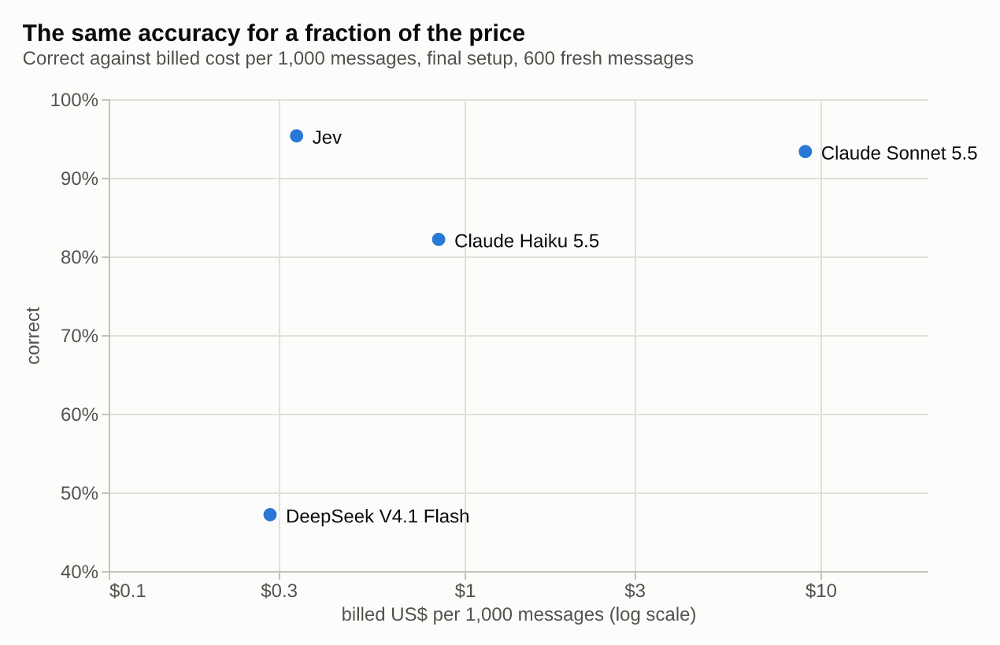

# Who picks the tool?

**Measuring tool selection on 90 real MCP tools: a small choice model against LLM agents.**

A customer writes to an online store's AI assistant. The assistant has 91 options: 90 tools copied word for
word from seven official MCP servers (Shopify, Stripe, Intercom, GitHub, Notion) and one that hands the
conversation to a person. Which should it pick first, and what happens when it picks wrong?

This study runs four selectors on the same 600 customer messages and scores every answer against an answer
key audited by hand: TypeSafe's **Jev** (a small model that answers one multiple-choice question) and
**DeepSeek V4.1 Flash, Claude Haiku 5.5 and Claude Sonnet 5.5** as tool-calling agents. Every raw API response
is committed, so every number below can be recomputed without an API key.


## What I found

| selector | correct | benign miss | harmful | median time | US$ per 1,000 messages |
|---|---|---|---|---|---|
| Jev (pick, then a call to fill the arguments) | 95.3% | 4.5% | 0.2% | 1.4 s | 0.34 |
| Claude Sonnet 5.5 | 93.3% | 6.7% | 0.0% | 1.8 s | 9.07 |
| Claude Haiku 5.5 | 82.2% | 17.8% | 0.0% | 1.7 s | 0.85 |
| DeepSeek V4.1 Flash | 47.2% | 52.5% | 0.3% | 2.0 s | 0.28 |

1. **A tie at the top, at 27 times the price.** Jev and Sonnet are two points apart, and on the same messages
   that isn't a real gap (exact McNemar p = 0.16). Sonnet costs US$9.07 per 1,000 messages; Jev US$0.34.
2. **Almost every miss is harmless.** A miss is usually a needless hand-off or a question back. Only 3 answers
   in 2,400 were a wrong call, once every model had a written routing policy and a hand-off option.
3. **How the model is allowed to answer matters more than which model it is.** DeepSeek scores 47% as a free
   agent and 91% when told to name one tool: a 44-point swing for the same model on the same messages.
4. **The setup moved the scores more than the models did.** Writing the routing policy into the prompt added
   7 to 33 points. One line of customer wording on six tool descriptions added 11. Auditing the answer key
   moved scores by up to 15 points and reordered the selectors.
5. **A word-counting baseline ties the leaders.** A naive Bayes intent classifier that looks the tool up in
   the answer key scores 95.2%. That says what this benchmark mostly measures, and it is the first limitation
   below.


## What weakens the result

I checked the headline against itself. Each of these is measured in the notebook (Part 5).

- **It is close to intent classification.** The answer key is per intent, so recognising a templated intent
  is most of the task. The naive Bayes baseline above shows how far that goes.
- **The ranking depends on the mix of requests.** Half the messages have no tool that fits. Jev is better on
  those (99.7% against 93.9%), Sonnet on the rest (92.7% against 90.7%). Below about 26% no-tool requests,
  Sonnet leads.
- **The messages aren't independent.** Resampling whole intents instead of messages widens the interval on
  Jev minus Sonnet from [-0.7, +4.5] to [-2.7, +6.5] points.
- **"Harm is rare" leans on a labelling rule added after the final run.** Reading the customer's own records
  or the FAQ counts as benign. Without that rule there are 79 harmful answers in 2,400, not 3, nearly all of
  them an FAQ search where the policy says to hand off.
- **Mode and model are tangled.** Jev must pick an option; the agents may ask a question. That is how each is
  deployed, but it is not a like-for-like comparison of models.
- **Synthetic, short, single-turn messages** (Bitext, template-generated), one run per selector, one store's
  tool list, and only the first call is scored.

## Look around

| | |
|---|---|
| [`notebooks/tool_selection.ipynb`](notebooks/tool_selection.ipynb) | **Start here.** The whole study in six parts: data, experiment (with a small live run), results, why, limitations, cost. Renders on GitHub. |
| [`docs/RESULTS.md`](docs/RESULTS.md) | Every table in full, including the variants that didn't make the headline (argument checks, a "need more information" option for Jev, a local contrastive model, prompt optimisation with GEPA). |
| [`src/toolpick/`](src/toolpick) | The package: data and answer key (`data.py`), scoring and paired statistics (`scoring.py`), prompts, the request builder used for every call (`live.py`), the argument check. |
| [`tests/`](tests) | 46 tests, including one file that pins the published numbers to the committed runs. |
| `ledger/index.html` | Every decision in every run on one filterable page (open it locally; 6 MB). |
| [`notebooks/rerun_failures.ipynb`](notebooks/rerun_failures.ipynb) | Re-sends sampled failures to see which repeat (needs keys; about US$0.40). |
| `notebooks/explore.py` | A marimo app for browsing the data and errors interactively. |
| [`data/REPORT.md`](data/REPORT.md) | Where each of the 90 tools came from: server, version, how it was retrieved, licence. |

## Run it

```bash
uv sync                                    # Python 3.12
uv run pytest                              # 46 tests, a few seconds, no network
uv run jupyter lab notebooks/              # the walkthrough
uv run marimo edit notebooks/explore.py    # the interactive explorer
```

None of that needs an API key. To make new calls, copy `.env.example` to `.env` and fill in the keys. The
notebook's live cells then send five messages to two selectors (a cent or less), and its `FULL_RUN` switch
repeats the whole final run (about US$6, nearly all of it Sonnet). The scripts behind each table are listed
in [`docs/RESULTS.md`](docs/RESULTS.md#commands).

To rebuild the generated files:

```bash
uv run python scripts/build_notebook.py && uv run jupyter nbconvert --to notebook --execute --inplace notebooks/tool_selection.ipynb
uv run python scripts/build_figures.py     # the charts on this page
uv run python scripts/build_ledger.py      # ledger/index.html
```

## How it is built

- **Real tools, with provenance.** Each tool's name, description and schema is the vendor's own, retrieved by
  running the official server and calling `tools/list` where possible. Nothing was paraphrased.
- **An answer key with a paper trail.** A first-pass key from the docs, then an audit of every failure. Each
  change is one line in `src/toolpick/data.py` with its reason, and both versions can be scored.
- **A held-out final sample.** The setup (policy, tool wording, key) was developed on 600 messages and tested
  once on 600 different ones.
- **Paired statistics.** Selectors are compared on the same messages with an exact McNemar test and a
  bootstrap interval, not by eyeballing two percentages.
- **Outcomes, not only accuracy.** Each answer is one of six outcomes that fold into correct, benign and
  harmful, because a hand-off and a wrong refund are not the same miss.
- **Everything is on disk.** One JSON line per call with the pick, usage, billed cost, latency, timestamp and
  the full API response. Runs append as they go and resume where they stopped.



## Layout

| Path | What |
|---|---|
| `data/requests_fresh.jsonl`, `data/requests.jsonl` | the 600 fresh messages (final results) and the first 600 (development) |
| `data/catalog.json`, `data/REPORT.md` | the 90 real tools and how each was retrieved |
| `data/intent_map.json` | the research pass behind the answer key: per intent, acceptable and partial tools with notes |
| `src/toolpick/` | the package (see above) |
| `runs/fresh/` | the final runs; `runs/fill/` holds the argument-filling calls for Jev's picks |
| `runs/*.jsonl`, `runs/experiments/` | development runs and the experiments on Jev's question |
| `scripts/run_*.py` | the runners; `scripts/build_*.py` generate the notebook, charts, ledger and slides |
| `clm/` | setup notes for running the CLM-8B contrastive model locally as a fifth selector |
| `slides/` | the draft deck (see below) |

## Background

I built this for a talk at MeasureCamp Sydney in October 2026. A late review of the draft turned up the
limitations listed above, and there wasn't time to do them justice, so I withdrew the talk and wrote the study
up instead. The draft deck is still in `slides/`. All the API calls together cost about US$30.

## Licences and provenance

Code: MIT (see `LICENSE`). Messages: Bitext customer-support dataset (CDLA-Sharing-1.0). Tool text: Stripe
(`@stripe/mcp` 0.2.5, MIT), GitHub (`github-mcp-server` 2.0.3, MIT), Notion (`@notionhq/notion-mcp-server`
2.5.2, MIT); Shopify (live `tools/list` on a public store) and Intercom (docs summaries) are the vendors' own
text, reproduced here for research. See `data/REPORT.md`.
